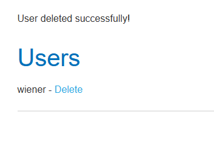

<<<<<<< HEAD
# PortSwigger Web Security Academy — Acesso indevido ao painel administrativo

## 1. Objetivo

Praticar testes de segurança em aplicações web em um ambiente controlado, identificando uma funcionalidade administrativa acessível sem passar pelo fluxo de autenticação esperado e verificando seu impacto.

## 2. Ambiente

- **Plataforma:** PortSwigger Web Security Academy
- **Ferramenta:** Burp Suite
- **Método de descoberta:** tentativa manual de navegação por rotas
- **Escopo:** laboratório autorizado da plataforma

## 3. Metodologia

Durante a exploração manual, testei diferentes rotas que poderiam estar relacionadas à administração da aplicação, incluindo `/admin`, `/administrator` e `/admin-panel`.

Após essas tentativas, identifiquei a rota:

`/administrator-panel`

Ao acessar esse endereço, consegui visualizar o painel administrativo e a lista de usuários, sem precisar fornecer o usuário e a senha que seriam esperados para acessar essa funcionalidade pelo fluxo normal da aplicação.

## 4. Resultado e impacto

O painel permitia visualizar usuários e executar a ação de exclusão. Realizei a exclusão de um usuário e a aplicação exibiu a mensagem:

`User deleted successfully!`

Isso demonstrou impacto real sobre a integridade dos dados da aplicação: uma funcionalidade administrativa capaz de excluir usuários estava acessível sem a autenticação esperada.

## 5. Classificação técnica

O achado é compatível com uma falha de **controle de acesso**, relacionada à exposição de funcionalidade administrativa sem a proteção adequada.

A classificação mais específica depende de como o laboratório implementa a falha. Se o painel não exigir autenticação, o caso pode ser descrito como funcionalidade administrativa desprotegida. Se houver autenticação, mas faltar uma verificação de autorização, pode também envolver uma falha de controle de acesso.

## 6. Evidências

- Rota identificada: `/administrator-panel`
- Acesso à lista de usuários sem fornecer as credenciais esperadas
- Captura de tela mostrando a mensagem `User deleted successfully!`
- Confirmação visual da funcionalidade de exclusão de usuários

## 7. Aprendizados

- A descoberta manual de rotas pode revelar funcionalidades que não estão visíveis na navegação comum.
- A existência de uma rota administrativa não é, por si só, uma vulnerabilidade; o problema é a ausência de controles de acesso adequados.
- A validação deve demonstrar o impacto da falha, e não apenas a existência de um endpoint.
- Evidências claras e uma descrição precisa do procedimento tornam um relatório técnico mais confiável.

## 8. Limites do teste

O teste foi realizado exclusivamente no laboratório autorizado da PortSwigger Web Security Academy. O resultado não deve ser generalizado para outras aplicações sem testes independentes.

